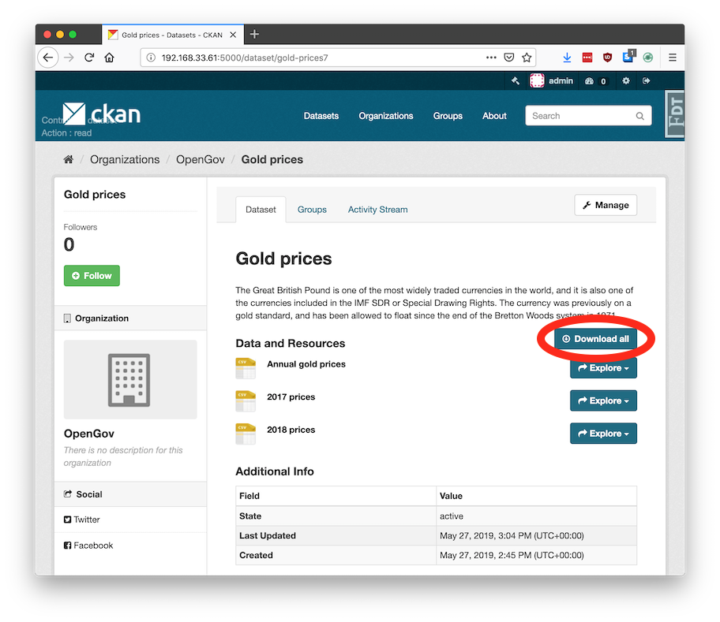

.. You should enable this project on travis-ci.org and coveralls.io to make
   these badges work. The necessary Travis and Coverage config files have been
   generated for you.

.. image:: https://travis-ci.org/davidread/ckanext-downloadall.svg?branch=master
    :target: https://travis-ci.org/davidread/ckanext-downloadall

.. image:: https://img.shields.io/pypi/v/ckanext-downloadall.svg
    :target: https://pypi.python.org/project/ckanext-downloadall/
    :alt: Latest Version

.. image:: https://img.shields.io/pypi/pyversions/ckanext-downloadall.svg
    :target: https://pypi.python.org/project/ckanext-downloadall/
    :alt: Supported Python versions

.. image:: https://img.shields.io/pypi/status/ckanext-downloadall.svg
    :target: https://pypi.python.org/project/ckanext-downloadall/
    :alt: Development Status

.. image:: https://img.shields.io/pypi/l/ckanext-downloadall.svg
    :target: https://pypi.python.org/project/ckanext-downloadall/
    :alt: License

===================
ckanext-downloadall
===================

This CKAN extension adds a "Download all" button to datasets. This downloads
a zip file containing all the resource files and a datapackage.json.

This zip file is a good way to package data for storing or sending, because:

* you keep all the data files together

* you include the documentation (metadata) - avoids the common problem of being
  handed some data files and not know anything about it or where to find info

* the metadata is machine-readable, so can be used by tools, software and in
  automated workflows. For example:

  * validating a series of data releases all meet a standard schema
  * loading it into a database, using the column types and foreign key
    relations specified in the metadata

The `datapackage.json <https://frictionlessdata.io/specs/data-package/>`_ is a
`Frictionless Data <https://frictionlessdata.io/specs/data-package/>`_
standard, also known as a Data Package.

Technical notes
~~~~~~~~~~~~~~~

If the resource is pushed/xloaded to DataStore then the schema (column types)
is also included in the datapackage.json file.

This extension uses a CKAN background job to create the zip every time a
dataset is created or updated (or its data dictionary is changed). This suits
CKANs where all files are uploaded - if the underlying data file changes
without the CKAN URL changing, then the zip will not include the update (until
something else triggers the zip to update).

(This extension is inspired by `ckanext-packagezip
<https://github.com/datagovuk/ckanext-packagezip>`_, but that is old and relied
on ckanext-archiver and IPipe.)

------------
Requirements
------------

=============== =============
CKAN version    Compatibility
=============== =============
2.6 and earlier don't know
2.7             yes
2.8             yes
2.11             yes

=============== =============

Designed to work with CKAN 2.7+

Ideally it is used in conjunction with DataStore and
`xloader <https://github.com/ckan/ckanext-xloader>`_ (or datapusher), so that the
Data Dictionary is included as a schema in the datapackage.json, to describe
the column types.

------------
Installation
------------

To install ckanext-downloadall:

1. Activate your CKAN virtual environment, for example::

     . /usr/lib/ckan/default/bin/activate

2. Install the ckanext-downloadall Python package into your virtual environment::

     pip install ckanext-downloadall

3. Add ``downloadall`` to the ``ckan.plugins`` setting in your CKAN
   config file (by default the config file is located at
   ``/etc/ckan/default/production.ini``). e.g. ::

     ckan.plugins = downloadall

4. Restart the CKAN worker. For example if you've deployed it with supervisord::

     sudo supervisorctl restart ckan-worker:ckan-worker-00

5. Restart CKAN server. For example if you've deployed CKAN with Apache on
   Ubuntu::

     sudo service apache2 reload

6. Ensure the background job 'worker' process is running - see
https://docs.ckan.org/en/2.8/maintaining/background-tasks.html#running-background-jobs

---------------
Config Settings
---------------

::

    # Include additional fields from the dataset in the datapackage.json (e.g.
    # those defined in a ckanext-scheming schema)
    # (optional, space separated list).
    ckanext.downloadall.dataset_fields_to_add_to_datapackage = district county

    # Queue for the zip jobs (default: bulk)
    ckanext.downloadall.queue = downloadall

    # Job deduplication strategy. ``request_cache`` is the default: one job
    # per dataset for each database commit. ``redis`` also coalesces changes
    # for the same dataset across requests and workers.
    ckanext.downloadall.dedup_strategy = request_cache

    # Redis coordination lock lifetime in seconds. Used only with the redis
    # strategy. Expired jobs verify/reacquire ownership when they start.
    # The effective value is at least job_timeout + 300 seconds.
    ckanext.downloadall.redis_lock_ttl = 3600

    # Zips only for high-value datasets (default: false), from this field
    ckanext.downloadall.hvd_only = true
    ckanext.downloadall.hvd_field = hvd_category

    # Resources left out of the zip (listed in downloadall-manifest.json).
    # Resources with downloadall_exclude=true are always left out. No format
    # or name is excluded by default, as before.
    ckanext.downloadall.exclude_resource_formats = API
    ckanext.downloadall.exclude_resource_name_patterns = ["capabilities document"]

    # Robustness, in seconds and bytes (0 = no limit)
    ckanext.downloadall.connect_timeout = 10
    ckanext.downloadall.read_timeout = 60
    ckanext.downloadall.retries = 1
    ckanext.downloadall.job_timeout = 1800
    # How many times update-all-zips --retry-failed rebuilds the same version
    # of a dataset (0 = no limit)
    ckanext.downloadall.retry_failed_limit = 3
    ckanext.downloadall.max_resources = 0
    ckanext.downloadall.max_resource_size = 0
    ckanext.downloadall.max_total_size = 0

Neither strategy scans the CKAN job queue. If Redis coordination is
temporarily unavailable, the extension falls back to enqueueing the job and
the worker's existing ``skip_if_no_changes`` check avoids rebuilding an
unchanged ZIP.

The web application and all workers consuming the DownloadAll queue must run
the same extension version. The ``redis`` strategy can then be enabled in the
shared CKAN configuration after the new code has been deployed everywhere.

**More than one worker on the DownloadAll queue requires ``redis``.** With
``request_cache`` two workers can build the same dataset at the same time.
Saving is still safe (each save takes a per-dataset database lock and
re-checks the dataset and its zip), but work is duplicated.

With ``redis``, a change made while a job is running is processed again by
the same job, or by a new job if the job fails or has no time left. Known
limitation: if a queued job is lost (e.g. the worker is killed or ``ckan jobs
clear`` is run), changes to that dataset do not queue a new job until the lock
expires (``redis_lock_ttl``). The daily ``update-all-zips --retry-failed``
below rebuilds such zips; if a job is already pending for a dataset, the
forced rebuild is passed to that job.

All options are declared in ``ckanext/downloadall/config_declaration.yaml``.

Each zip contains ``datapackage.json`` and ``downloadall-manifest.json``
(included / excluded / failed resources with a short reason). The zip resource
stores a fingerprint of the dataset metadata (``downloadall_fingerprint``): the
"Download all" button is disabled while the dataset has changed and the zip is
being rebuilt. If the rebuild fails (no resource could be downloaded, the
dataset does not pass validation, timeout), the previous zip stays available.
Before a new zip is saved, the dataset is read again: if it is no longer
eligible (e.g. made private) the zip is not saved; if it changed during the
build, the zip is saved as out of date and the dataset is processed again
(unless a newer zip was already saved). After a successful rebuild, the exact
blob of the previous zip is deleted (ckanext-cloudstorage), but only once the
new blob is found in the storage with the size of the uploaded zip; otherwise
the previous blob is kept and an error is logged. The same check is made by
``cleanup --apply`` before it deletes superseded blobs.

When a ``package_update`` call passes a ``resources`` list without the
existing DownloadAll zip (for example from harvesters such as WMS, CSW, DCAT
or CKAN, or from API scripts), the extension preserves the zip resource under
the same id instead of letting CKAN delete it and leave an orphaned blob in
cloud storage. A forced rebuild is then queued after commit so refreshed data
behind unchanged URLs/ids is picked up on the same zip resource, without
counting towards ``downloadall_retries``. Explicit ``resource_delete`` calls
and partial updates that omit ``resources`` are not affected.

No zip is created for draft, deleted or private datasets, or when none of the
resources can go into the zip; the button is then hidden. A private dataset
gets its zip when it is made public. The zip of a dataset that becomes private
is removed by its next job, or by ``cleanup``.

Run ``update-all-zips --retry-failed`` daily (cron), so that zips that are
missing or out of date are rebuilt, and resources that failed temporarily
(timeout, connection error, HTTP 5xx or 429) are tried again. Permanent
failures (e.g. 404, 403, size or time limit) are not retried every night; they
are tried again when the dataset changes. The same version of a dataset is
rebuilt at most ``retry_failed_limit`` times, counting failed builds too (for a
dataset without a zip they are kept in Redis for 30 days). It also covers
changes to ``exclude_resource_formats``, ``exclude_resource_name_patterns`` and
``dataset_fields_to_add_to_datapackage``, which make existing zips out of
date.

Zips made before this version (without ``downloadall_fingerprint``) are shown
as ready and are **not** rebuilt by ``--retry-failed``: a rebuild also deletes
the old blob, and old zips must not be replaced automatically at deployment.
They are rebuilt when their dataset changes, or in a planned run of
``update-all-zips`` (e.g. for the HVD scope, after ``--dry-run``). For
example::

    30 3 * * * /usr/lib/ckan/default/bin/downloadall -c /etc/ckan/default/production.ini update-all-zips --retry-failed

An error in one dataset does not stop ``update-all-zips``; the errors are
printed and counted, and the command exits with a non-zero status if any
dataset failed. With ``--synchronous`` each dataset has the same time limit as
a job (``job_timeout``), so a slow server cannot hold the command.

----------------------
Command-line interface
----------------------

There is a command-line interface::

    downloadall --help

Examples of use::

    downloadall update-zip gold-prices
    downloadall update-all-zips             # eligible datasets only (e.g. HVD)
    downloadall update-all-zips --dry-run
    downloadall update-all-zips --retry-failed          # missing, out of date or with temporary failures
    downloadall cleanup --output report.json            # dry-run inventory
    downloadall cleanup --apply --limit 100             # delete obsolete zips/blobs

``cleanup`` deletes the zips of datasets that are no longer eligible (e.g.
non-HVD with ``hvd_only``), duplicate zips of a dataset (keeping the first
one in resource order, the one the zip job updates and the page shows)
and superseded zip blobs under ``resources/<zip resource id>/``. It never
touches anything else in the storage container. A failed deletion is recorded
in the report and the command carries on; ``--limit`` counts successful
deletions.

---------------
Troubleshooting
---------------

**"All resource data" appears as a normal resource, instead of seeing a
"Download All" button**

You need to enable this extension in the CKAN config and restart the server.
See the Installation section above.

**ImportError: No module named datapackage**

This means you have an older version of ckanapi, which is a dependency of
ckanext-downloadall. Install a newer version.

**Files in the ZIP archive show incorrect modification dates (e.g., 01/01/1980)**

This issue has been fixed in the latest version. The extension now preserves the original 
file timestamps for local resources, attempts to use the Last-Modified header for 
downloaded resources, and uses the current time for dynamically generated files like 
datapackage.json. If you're still seeing this issue, make sure you're using the latest 
version of the extension.

**OSError: [Errno 13] Permission denied: '/data/ckan/resources/c89'**

You are trying to update zips from the command-line but running the tasks
synchronously, rather than with the normal worker process. In this case you
need to run it as the `www-data` user e.g.::

    sudo -u www-data /usr/lib/ckan/default/bin/downloadall -c /etc/ckan/default/production.ini update-all-zips --synchronous

------------------------
Development Installation
------------------------

To install ckanext-downloadall for development, activate your CKAN virtualenv
and do::

    git clone https://github.com/davidread/ckanext-downloadall.git
    cd ckanext-downloadall
    python setup.py develop
    pip install -r dev-requirements.txt

Remember to run the worker (in a separate terminal)::

    paster --plugin=ckan jobs worker --config=/etc/ckan/default/development.ini

-----------------
Running the Tests
-----------------

The tests use pytest and the CKAN pytest plugin, with PostgreSQL, Solr and
Redis as configured in ``test.ini``. To run them, do::

    pytest --ckan-ini=test.ini ckanext/downloadall/tests

To produce a coverage report, first make sure you have pytest-cov installed in
your virtualenv (``pip install pytest-cov``) then run::

    pytest --ckan-ini=test.ini --cov=ckanext.downloadall ckanext/downloadall/tests

----------------------------------------------
Releasing a New Version of ckanext-downloadall
----------------------------------------------

ckanext-downloadall is availabe on PyPI as https://pypi.org/project/ckanext-downloadall/.
To publish a new version to PyPI follow these steps:

1. Update the version number in the ``setup.py`` file.
   See `PEP 440 <http://legacy.python.org/dev/peps/pep-0440/#public-version-identifiers>`_
   for how to choose version numbers.

2. Update the CHANGELOG.md with details of this release.

3. Make sure you have the latest version of necessary packages::

       pip install --upgrade setuptools wheel twine

4. Create a source and binary distributions of the new version::

       python setup.py sdist bdist_wheel && twine check dist/*

   Fix any errors you get.

5. Upload the source distribution to PyPI::

       twine upload dist/*

6. Commit any outstanding changes::

       git commit -a
       git push

7. Tag the new release of the project on GitHub with the version number from
   the ``setup.py`` file. For example if the version number in ``setup.py`` is
   0.0.1 then do::

       git tag 0.0.1
       git push --tags
